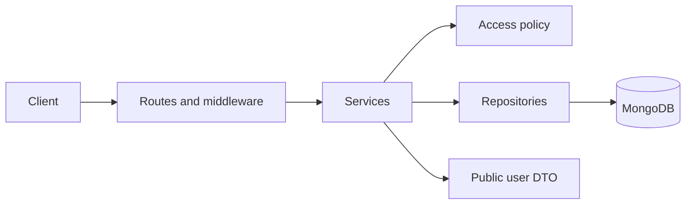

# Grocery Store API

A REST API for managing employee and manager accounts across a tree of offices and stores. Built with Node.js 24, Express 5 and MongoDB.

Access depends on the user's role and where they belong in the organization:

- Employees can read employee accounts at their own node and below it.
- Managers can create, read, update and delete both employees and managers within that same scope.

For example, a manager assigned to Novi Beograd can manage accounts in Novi Beograd, Bežanija and Radnja 6, but cannot access the Vračar branch.

## Run the project

You'll need Git, Node.js 24.x and a running Docker installation with Compose.

```bash
git clone https://github.com/markomijanovic/grocery-store-api.git
cd grocery-store-api
npm run setup
docker compose up --build -d --wait
docker compose exec -T api node scripts/seed.js
docker compose exec -T api node scripts/demo.js
```

The setup script creates a local `.env` with a random JWT secret and demo password. If `.env` already exists, it leaves it alone. Docker installs the application dependencies during the build.

The seed adds 23 organization nodes and 46 accounts to a fresh database: one employee and one manager per node. The demo signs in, checks access rules and runs CRUD operations for both roles. It should finish with `Demo passed` and remove the temporary accounts it created.

By default, the API is at `http://127.0.0.1:3000` and MongoDB is exposed on localhost port `27018`.

```bash
curl http://127.0.0.1:3000/health
curl http://127.0.0.1:3000/ready
```

Expected responses are `{"status":"ok"}` and `{"status":"ready"}`. The second endpoint also checks the database connection.

If you use a different `PORT` in `.env`, use that port in requests and Postman. If you change `MONGO_PORT`, also update the port in `MONGODB_URI` for commands run on the host. Inside Docker, the API connects to `mongo:27017`.

To stop the services, run `docker compose down`. The database volume is kept for the next run.

## Try the API

Import [the Postman collection](docs/Grocery-Store-API.postman_collection.json), then set its `baseUrl` and `demoPassword` variables. The password is the `SEED_PASSWORD` value from your local `.env`.

Run **Login as manager** and **Login as employee** first. Their response scripts save the tokens used by the remaining requests. The collection includes account creation, updates, deletion, lists and requests that should be denied.

Some useful seed accounts:

| Email | Access |
|---|---|
| `manager.srbija@example.test` | Both account types across the whole tree |
| `manager.novi-beograd@example.test` | Both account types in Novi Beograd and its descendants |
| `employee.novi-beograd@example.test` | Read-only access to employees in those nodes |

All seed accounts use `SEED_PASSWORD`. Changing that setting after seeding does not reset existing passwords; rerunning the seed preserves existing accounts.

If you prefer curl, start with login:

```bash
curl -X POST http://127.0.0.1:3000/api/v1/auth/login \
  -H 'Content-Type: application/json' \
  -d '{"email":"manager.novi-beograd@example.test","password":"PASTE_YOUR_SEED_PASSWORD"}'
```

Copy the returned `accessToken` into `TOKEN`:

```bash
TOKEN='paste-access-token-here'
curl -H "Authorization: Bearer $TOKEN" \
  'http://127.0.0.1:3000/api/v1/nodes/novi-beograd/employees?includeDescendants=true'
```

On a fresh seed this returns three employees. With `includeDescendants=false`, it returns only the one assigned directly to Novi Beograd. Asking for `/nodes/vracar/employees` with that token returns 404 because Vračar is outside its scope.

## Endpoints

All paths below start with `/api/v1`. Apart from login, they require an `Authorization: Bearer <token>` header. Access tokens last 15 minutes.

| Method | Path | Action |
|---|---|---|
| POST | `/auth/login` | Sign in |
| GET | `/auth/me` | Get the current account |
| POST | `/employees`, `/managers` | Create an account |
| GET | `/employees/:id`, `/managers/:id` | Get an account |
| PATCH | `/employees/:id`, `/managers/:id` | Update an account |
| DELETE | `/employees/:id`, `/managers/:id` | Delete an account |
| GET | `/nodes/:nodeId/employees` | List employees |
| GET | `/nodes/:nodeId/managers` | List managers |

User IDs are MongoDB ObjectId strings. Node IDs are slugs such as `novi-beograd`.

Example body for creating an account:

```json
{
  "firstName": "Alex",
  "lastName": "Reviewer",
  "email": "alex@example.test",
  "password": "Example-Password-123!",
  "nodeId": "bezanija"
}
```

The route determines the role. PATCH accepts `firstName`, `lastName`, `email` and `nodeId`, with at least one field required. Role and password changes are not supported. Unknown fields are rejected. Emails are trimmed, lowercased and unique across both account types; passwords must be 12–128 characters when creating an account.

List endpoints accept `includeDescendants` (`true` or `false`, default `false`), `page` (1–10000, default 1) and `limit` (1–100, default 20). Results are flat and ordered by `_id`:

```json
{
  "data": [],
  "meta": { "page": 1, "limit": 20, "hasNext": false }
}
```

Creation returns 201 with a `Location` header. Deletion returns 204 with no body. Missing resources and resources outside the caller's scope both return 404. An action forbidden for the caller's role returns 403; a duplicate email or a conditional-write conflict returns 409.

Errors follow this format:

```json
{
  "error": { "code": "RESOURCE_NOT_FOUND", "message": "Resource not found." }
}
```

## Local development and tests

To run Node directly while keeping MongoDB in Docker:

```bash
npm ci
npm run setup
docker compose stop api
docker compose up -d --wait mongo
npm run seed
npm run dev
```

`npm run dev` restarts the server when source files change. `npm start` runs without watching. Stop the local process before starting Docker's API again on the same port.

```bash
npm test
npm run test:integration
```

There are 16 unit tests and 28 HTTP integration tests. Unit tests do not need MongoDB. Integration tests use separate `grocery_test_*` databases and clean up their own data. They use `MONGODB_URI` unless `TEST_MONGODB_URI` is set. `npm run test:all` runs both groups.

The tests cover permissions across the tree, authentication, both CRUD workflows, moves between nodes, pagination, concurrent duplicate emails and seed behavior. To exercise an already running API, use `npm run demo`.

## How the code is organized



Routes handle HTTP input and responses. Services carry out the account operations and check permissions. Repositories contain the MongoDB queries. `bootstrap.js` creates these objects and passes their dependencies in, so the services can also be tested with small test doubles.

Both account types share the `users` collection and the same service. Organization nodes store `parentId` and an `ancestors` array. A node is in scope when it is the caller's own node or has that node among its ancestors.

Passwords are hashed with Argon2id. JWTs identify the account, while its current role and node are loaded from MongoDB on each authenticated request. Moving or deleting an account therefore affects its next request. Public responses use an explicit field list and never include password hashes.

Moving an account requires access to both its current and destination nodes. Update and delete filters include the previously checked node and role to catch changes before the write. This is not full document versioning: concurrent profile edits can still use last-write-wins. Email uniqueness is enforced by a MongoDB unique index.

The organization tree is seeded from the supplied diagram; editing the tree is outside this API's scope. There is no password-reset or refresh-token flow. The login limiter stores its counters in one process, so running multiple API instances would require a shared store.

See [architecture.md](docs/architecture.md) for the request flow and concurrency details, and [assumptions.md](docs/assumptions.md) for the remaining behavior choices.
