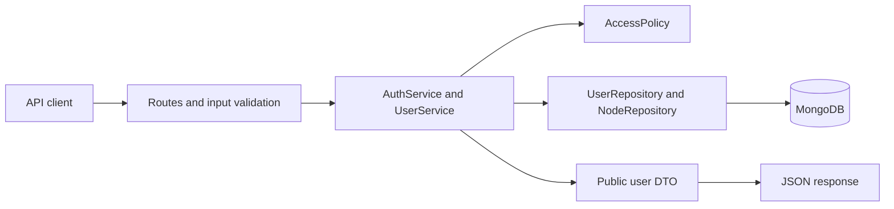

# Grocery Store API

A Node.js HTTP API for employee and manager accounts in an organizational hierarchy. Permissions combine the caller's role with their assigned node and its descendants.

Includes authentication, CRUD for both roles, direct-node and subtree lists, pagination, an idempotent seed, and Docker Compose.

**Verified:** 44 automated tests (16 unit + 28 HTTP integration), plus a 19-request end-to-end demo. The read policy checks all 2,116 role/node combinations against an independent parent-traversal oracle.

- [Run and verify](#quick-review-with-docker)
- [Demo accounts](#demo-accounts)
- [Postman walkthrough](#postman-walkthrough)
- [API contract](#api-contract)
- [Architecture](docs/architecture.md) and [business assumptions](docs/assumptions.md)

## Requirements

- Node.js 24.x and npm.
- Docker Desktop or Docker Engine with Docker Compose.
- Free local ports 3000 and 27018 by default.

No cloud database account is required. Organization names retain the labels in the supplied diagram; code, API messages and documentation are in English.

## Quick review with Docker

Requires Node.js 24.x for the environment setup script, Git, and a running Docker engine with Compose. Docker installs the application's runtime dependencies during the image build.

```bash
git clone https://github.com/markomijanovic/grocery-store-api.git
cd grocery-store-api
npm run setup
docker compose up --build -d --wait
docker compose exec -T api node scripts/seed.js
docker compose exec -T api node scripts/demo.js
```

The seed creates **23 organization nodes and 46 demo accounts** on a fresh database. The demo exercises login, allowed and forbidden scopes, and create/read/update/move/delete for both account types. It finishes with `Demo passed` and removes the temporary accounts it creates.

Default API URL: **http://127.0.0.1:3000**. This is an HTTP API; use its routes or the Postman collection to interact with it.

```bash
curl http://127.0.0.1:3000/health
curl http://127.0.0.1:3000/ready
docker compose ps
```

Both health endpoints should return HTTP 200. Their bodies are `{"status":"ok"}` and `{"status":"ready"}` respectively. Both Compose services should be healthy.

To run all automated tests against the running MongoDB service:

```bash
npm ci
npm run test:all
```

Expected result: **16 passing unit tests and 28 passing HTTP integration tests**. Integration tests create unique databases and clean up only their own test data.

`npm run setup` uses Node's standard library. It creates an ignored `.env` with a random JWT secret and a random local demo password. Existing environment files are preserved.

| Setting | Default | Purpose |
|---|---|---|
| `PORT` | `3000` | API port on the host |
| `MONGO_PORT` | `27018` | MongoDB port on the host |
| `MONGODB_URI` | `mongodb://127.0.0.1:27018` | Database connection for local Node commands and tests |
| `MONGODB_DB` | `grocery_store_dev` | Development database |

The API URL follows `PORT` in your `.env`. If you already have an environment file, use its configured port in examples and Postman. Containers use API port 3000 and the internal `mongo:27017` address regardless of the host port mappings. Changing `MONGO_PORT` also requires updating the port in `MONGODB_URI` for local Node commands and tests.

Stop the application with `docker compose down`; its named MongoDB volume is retained.

## Local Node development

```bash
npm ci
npm run setup
docker compose up -d --wait mongo
npm run seed
npm run dev
```

`npm run dev` restarts the process when source files change. `npm start` runs without watch mode. Stop Docker's API container before starting a local Node process on the same port.

Fixtures are upserted by stable node ID and canonical demo-account email. On a fresh database it creates 23 organization nodes and 46 accounts: one employee and one manager per node. Re-running it preserves existing profiles/passwords and does not duplicate fixtures. Conflicting organization paths are rejected instead of silently overwritten.

## Demo accounts

Use the `SEED_PASSWORD` generated in your ignored `.env` file. Every local demo account uses that password, with an independently salted hash. Set it before the first seed; changing it later does not reset existing account passwords.

| Email | Role and scope |
|---|---|
| `manager.srbija@example.test` | Manager of the complete tree |
| `manager.novi-beograd@example.test` | Manager of Novi Beograd, Bežanija and Radnja 6 |
| `employee.novi-beograd@example.test` | Read-only access to employees in those same nodes |
| `manager.vracar@example.test` | Manager of a separate branch |

Other fixtures follow `<role>.<node-id>@example.test`. These credentials are for local review only.

## Example walkthrough

Replace `PASTE_YOUR_SEED_PASSWORD` with the value from your local `.env`. Examples use the default API port 3000; use your configured `PORT` when it differs.

```bash
curl -X POST http://127.0.0.1:3000/api/v1/auth/login \
  -H 'Content-Type: application/json' \
  -d '{"email":"manager.novi-beograd@example.test","password":"PASTE_YOUR_SEED_PASSWORD"}'
```

Copy `accessToken` from the response:

```bash
TOKEN='paste-access-token-here'
curl -H "Authorization: Bearer $TOKEN" \
  'http://127.0.0.1:3000/api/v1/nodes/novi-beograd/employees?includeDescendants=false'
curl -H "Authorization: Bearer $TOKEN" \
  'http://127.0.0.1:3000/api/v1/nodes/novi-beograd/employees?includeDescendants=true'
curl -H "Authorization: Bearer $TOKEN" \
  'http://127.0.0.1:3000/api/v1/nodes/vracar/employees'
```

On a fresh seed, the first two queries return one and three employees respectively. The third returns 404: Vračar is outside the caller's scope. An employee token receives 403 for manager queries or any mutation.

## Postman walkthrough

The [Postman collection](docs/Grocery-Store-API.postman_collection.json) contains 17 prepared requests with URLs, headers, bodies, and token-saving scripts.

1. In Postman, choose **Import**, then select `docs/Grocery-Store-API.postman_collection.json`.
2. Open the collection's variables and set `baseUrl` to your API URL; the default is `http://127.0.0.1:3000`.
3. Set `demoPassword` to the `SEED_PASSWORD` in your local `.env`.
4. Run **Login as manager** and **Login as employee**. Their response scripts save the tokens for subsequent requests.
5. Run the prepared identity, list, forbidden-scope, and CRUD requests. The delete requests remove accounts created by the collection.

The exported collection contains no real credentials or access tokens. The default manager is assigned to Novi Beograd, so its scope is Novi Beograd, Bežanija, and Radnja 6.

For an automated walkthrough from the host, run `npm run demo` while the API is running. It reads the configured port and demo password from `.env` and does not print credentials.

## API contract

Business routes use `/api/v1` and Bearer authentication, except login. User IDs must be 24-character ObjectId hex strings. Node IDs are stable slugs such as `novi-beograd`.

| Method | Route | Purpose |
|---|---|---|
| POST | `/auth/login` | Obtain a 15-minute access token |
| GET | `/auth/me` | Read the current account |
| POST | `/employees`, `/managers` | Create an account of the route's type |
| GET | `/employees/:id`, `/managers/:id` | Read an account |
| PATCH | `/employees/:id`, `/managers/:id` | Edit a profile or its assigned node |
| DELETE | `/employees/:id`, `/managers/:id` | Delete an account |
| GET | `/nodes/:nodeId/employees` | List employees directly or throughout a subtree |
| GET | `/nodes/:nodeId/managers` | List managers directly or throughout a subtree |

Create body:

```json
{
  "firstName": "Alex",
  "lastName": "Reviewer",
  "email": "alex@example.test",
  "password": "Example-Password-123!",
  "nodeId": "bezanija"
}
```

PATCH accepts at least one of `firstName`, `lastName`, `email`, `nodeId`. Unknown fields, role/credential changes and client-supplied timestamps are rejected. Passwords are 12-128 characters on creation and are never trimmed. Email is trimmed, lowercased and globally unique across both types.

| List parameter | Default | Accepted values |
|---|---|---|
| `includeDescendants` | `false` | Exactly `true` or `false`; subtree mode includes the starting node |
| `page` | `1` | Integers 1-10000 |
| `limit` | `20` | Integers 1-100 |

Unknown or repeated query arguments are rejected. Lists have stable `_id` ordering and return a flat collection; the tree controls scope, not JSON nesting.

```json
{
  "data": [],
  "meta": { "page": 1, "limit": 20, "hasNext": false }
}
```

Create/read/update responses contain only public user fields. Create returns 201 and a `Location` header; delete returns 204 without a body. No response contains password hashes.

Errors use a consistent envelope:

```json
{
  "error": { "code": "RESOURCE_NOT_FOUND", "message": "Resource not found." }
}
```

| Status | Meaning |
|---|---|
| 400 | Invalid input, malformed JSON or protected fields |
| 401 | Missing/invalid token or invalid login credentials |
| 403 | The actor's role cannot perform this action |
| 404 | Missing resource, wrong account type, or resource outside scope |
| 409 | Duplicate normalized email or a target moved during a conditional mutation |
| 413 | JSON body exceeds 16 KB |
| 429 | Too many failed login attempts; includes `Retry-After` |
| 500 | Unexpected failure; internal details are not exposed |
| 503 | Readiness check cannot reach MongoDB |

## Tests

Unit tests require no database:

```bash
npm ci
npm test
```

For HTTP integration tests, create `.env` and start MongoDB first:

```bash
npm run setup
docker compose up -d --wait mongo
npm run test:integration
# Or run both groups:
npm run test:all
```

Integration tests create unique `grocery_test_*` databases and remove only those databases. They do not seed, modify or delete development data. `TEST_MONGODB_URI` can select another MongoDB instance; by default tests use `MONGODB_URI` from `.env`.

Checks cover:

- All 2116 read combinations across roles and nodes, using an independent parent-traversal oracle.
- Mutation scopes, validation, safe DTOs and conditional-write conflicts.
- Authentication, token signatures/claims/expiry and login rate limiting.
- Both CRUD workflows, all four list modes, direct-ID access and forbidden branches.
- Both unauthorized movement directions, current actor reassignment and self-deletion.
- Concurrent duplicate email writes, protected fields, pagination, seed idempotence and safe operational errors.

## Architecture and decisions



| Layer | Responsibility | Entry points |
|---|---|---|
| HTTP | Authentication middleware, validation, status codes and error envelopes | `src/auth/`, `src/users/users.routes.js`, `src/http/` |
| Services | Login and account workflows, including permission checks | `auth.service.js`, `users.service.js` |
| Policy | Role permissions and hierarchy boundaries | `src/policies/access.policy.js` |
| Repositories | MongoDB queries and conditional mutations | `users.repository.js`, `nodes.repository.js` |
| DTO | Explicitly selected public user fields | `users.dto.js` |
| Composition | Construct and inject concrete dependencies | `src/bootstrap.js` |
| Runtime | Configuration, startup, readiness and graceful shutdown | `src/config.js`, `src/server.js` |

Both account types use one collection and one user service. Their routes provide the trusted target role. The organization uses `parentId` and an `ancestors` array, with an index for subtree queries.

Authentication verifies the JWT and reloads the current user from MongoDB on every request. Authorization then checks the current role and node assignment. Password hashes are excluded from public responses through projections and explicit DTO mapping.

Before a move, the service checks both the source and destination nodes. Conditional update/delete filters also include the previously checked node and account role. A unique normalized-email index handles concurrent duplicate requests; conflicts map to HTTP 409.

See the [architecture walkthrough](docs/architecture.md) for request flow, storage choices, concurrency limits and alternatives. The [business assumptions](docs/assumptions.md) document decisions such as immutable roles, self-deletion, flat lists and the single-process rate limiter.
