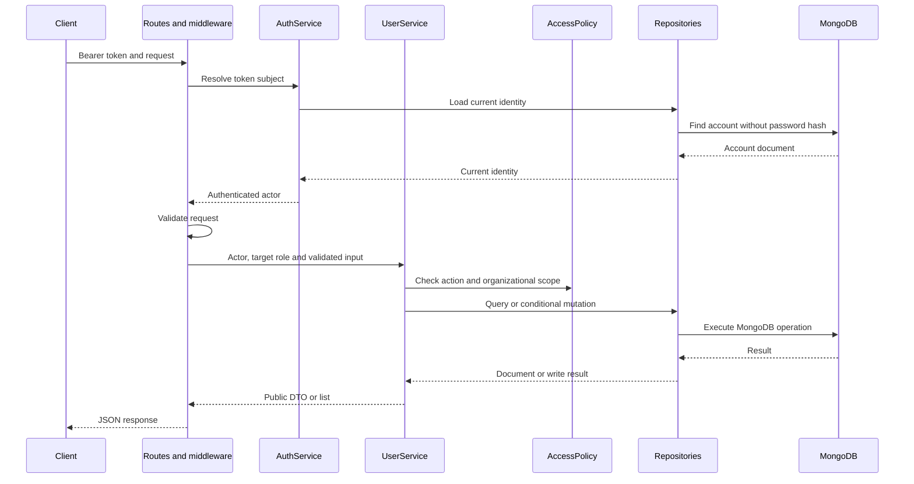

# Architecture

The application is a single Node.js process with explicit HTTP, service, policy, repository and DTO boundaries. Dependencies are constructed in `bootstrap.js` and supplied as function arguments.

## Request flow



Role prohibitions are checked before target-resource lookup. Each service also enforces its permissions, so an additional transport cannot bypass the rules by calling it directly.

## Boundaries and patterns

| Component | Responsibility | Why it exists |
|---|---|---|
| Routes and Zod schemas | Parse HTTP input, choose the target role, validate known fields and return status codes | Keep transport details separate from account workflows |
| AuthService | Check credentials, issue tokens and resolve current identities | Keep identity verification in one place |
| UserService | Coordinate CRUD and list operations with permission checks | Apply the same workflows to both account types |
| AccessPolicy | Decide role permissions and whether a node belongs to the actor's subtree | Centralize business rules and allow exhaustive tests without a database |
| Repositories | Own MongoDB queries, projections, pagination and conditional writes | Keep database operations out of routes and services |
| Public DTO mapper | Enumerate output fields and convert ObjectId to a string | Prevent password hashes or future internal fields from being serialized |
| bootstrap.js | Construct repositories, cryptographic adapters, services and the app | Make dependencies explicit through manual dependency injection |
| server.js | Open MongoDB, ensure indexes, start HTTP and handle termination | Keep process side effects separate from the testable app factory |

Factory functions provide small concrete interfaces. The implementation uses the Service Layer, Repository, Policy and DTO patterns with manual dependency injection.

## Storage model

`nodes` stores a stable string `_id`, `name`, `type`, `parentId` and ordered `ancestors` from root to immediate parent. The ancestors array excludes the node itself.

For example, Radnja 6 has parent `bezanija` and ancestors:

```json
["srbija", "grad-beograd", "novi-beograd", "bezanija"]
```

`users` stores a MongoDB-generated ObjectId, one role (`employee` or `manager`), one node ID, profile fields, a password hash and timestamps. Both account types share the collection and its global email uniqueness constraint.

The seed constructs paths from parent links and rejects duplicate IDs, missing parents, multiple roots and cycles. It uses stable node IDs and canonical demo emails as idempotency keys with insert-only upserts. Existing profiles and password hashes are preserved. Existing organization paths are verified after the upserts.

## Scope and lists

A node is accessible when its ID equals the actor's assigned node or its ancestors contain that node ID. Managers can manage and read both account types in that scope. Employees can read employees in that scope.

The service first authorizes the requested starting node. For descendant mode, it then queries nodes whose ancestors contain that starting ID and includes the starting node once. The user query filters by target role and the resulting node IDs, with a password-hash projection, stable ObjectId ordering, and a bounded page size.

Lists are flat. Pagination fetches `limit + 1` records, returns at most `limit`, and uses the extra record to calculate `hasNext`.

## Authentication and safe output

Passwords use Argon2id with independently generated salts and parameters of 19 MiB memory, two passes and parallelism one. Unknown login emails still perform a verification against a dummy hash to reduce obvious timing differences. Invalid credentials receive the same generic response.

JWTs use HS256 and contain a subject, issuer, audience, issued time and 15-minute expiry. Verification restricts the algorithm and token type, checks the intended issuer and audience, requires the relevant claims, and validates the subject as an ObjectId string.

Every authenticated request reloads its user. Tokens contain identity rather than cached role or node permissions. Reassignment therefore takes effect on the next request, and deleted accounts are rejected. Database failures propagate as server failures rather than being mislabeled as invalid tokens.

The login query needs the hash internally. Identity queries exclude it, and responses use an explicit whitelist DTO. Logs record request IDs and error types without logging credentials or internal exception messages.

## Example: moving an employee

For a manager assigned to Novi Beograd moving an employee from Bežanija to Radnja 6:

1. Authentication loads the manager's current role and assignment.
2. The route selects the employee account type and validates the ID and PATCH fields.
3. The service reads the employee and checks access to its current node, Bežanija.
4. It loads Radnja 6 and checks access to the destination.
5. The repository updates by ObjectId, account role and the previously read node. If that condition no longer matches, the service reports HTTP 409.
6. The updated account is returned through the public DTO mapper.

## Concurrency guarantees and limits

A normalized-email unique index enforces uniqueness across both roles during concurrent requests. Duplicate-key errors become HTTP 409; an application-level existence check alone would not enforce that rule.

Conditional mutations reject targets whose node or role no longer matches the read snapshot. This is a node/role comparison rather than full version-based optimistic concurrency. Moving out and back to the same node can escape that comparison, and ordinary concurrent profile edits use last-write-wins. Actor and target changes are not authorized in one serializable transaction. Stricter guarantees would require version checks and potentially transactions or a broader consistency design.

## Tree model and deployment choices

The [Array of Ancestors](https://www.mongodb.com/docs/manual/tutorial/model-tree-structures-with-ancestors-array/) model supports direct scope checks and indexed subtree reads. Adding a leaf can derive its path from its parent; moving a branch would require updating its descendants. Organization editing is outside the required API scope.

[Nested Sets](https://www.mongodb.com/docs/manual/tutorial/model-tree-structures-with-nested-sets/) is another MongoDB-compatible model, using traversal boundaries for subtree range queries. Structural edits can require renumbering many boundaries. A parent-only model would instead require traversal or aggregation for subtree reads.

The application runs as a single API service plus MongoDB. The required workflow is synchronous CRUD with indexed hierarchy queries; it does not require a cache or asynchronous event delivery. Additional instances would require a deliberately shared rate-limit store and proxy configuration. Docker images are pinned by digest, dependencies are locked, the API runs as a non-root user, and secrets are supplied at runtime.

Operational checks distinguish HTTP liveness (`/health`) from database readiness (`/ready`). Shutdown drains HTTP requests and closes MongoDB within a bounded deadline.

For the complete behavioral choices, see [business assumptions](assumptions.md).
